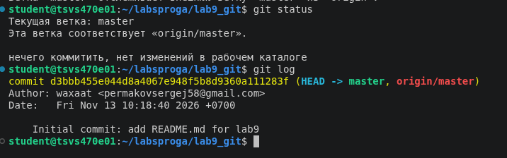
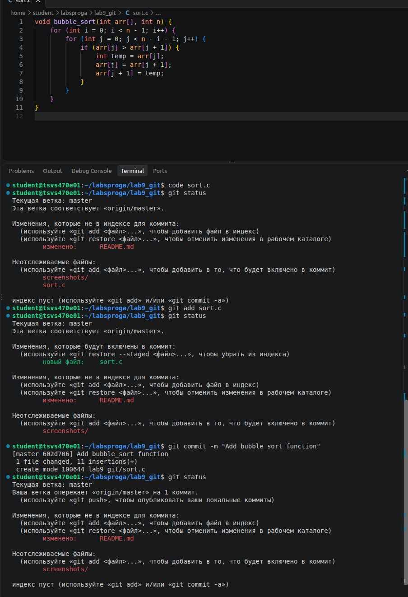
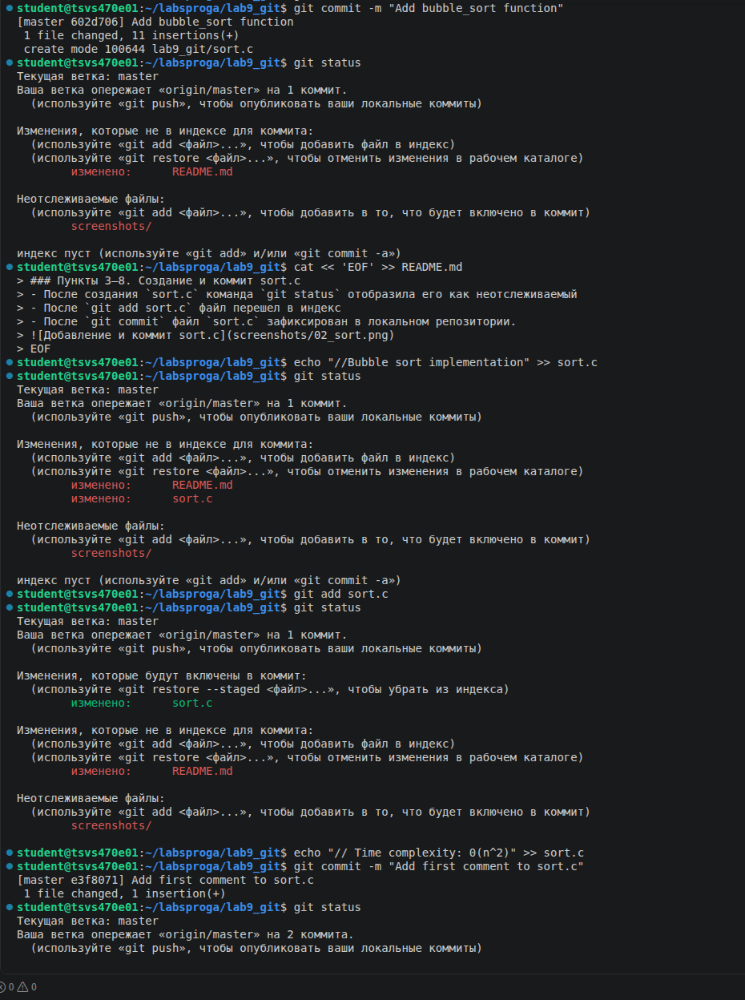
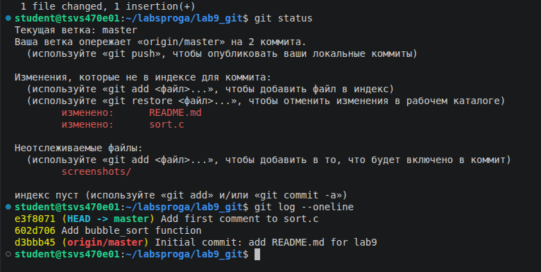

#Практическое задание 9. Git
## Оценка 3. Часть 1: Базовый цикл Git

### Пункты 1-2. Проверка ветки и журнала
- Команда `git status` показала, что мы находимся на ветке `master` изменений нет
- Команда `git log` вывела начальный коммит с файлом `README.md`

### Пункты 3–8. Создание и коммит sort.c
- После создания `sort.c` команда `git status` отобразила его как неотслеживаемый
- После `git add sort.c` файл перешел в индекс
- После `git commit` файл `sort.c` зафиксирован в локальном репозитории.

### Пункты 9–17. Редактирование файла и работа со stage
- После первого комментария и `git add` изменение попало в индекс.
- После второго комментария (без `git add`) команда `git commit` зафиксировала только первое изменение, а второе осталось неиндексированным.
- Затем второе изменение было добавлено в индекс, закоммичено и отправлено на GitHub

