# Практическое задание 9. Git
## Оценка 3. Часть 1: Базовый цикл Git

### Пункты 1-2. Проверка ветки и журнала
- Команда `git status` показала, что мы находимся на ветке `master` изменений нет
- Команда `git log` вывела начальный коммит с файлом `README.md`

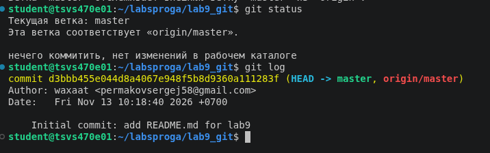
### Пункты 3–8. Создание и коммит sort.c
- После создания `sort.c` команда `git status` отобразила его как неотслеживаемый
- После `git add sort.c` файл перешел в индекс
- После `git commit` файл `sort.c` зафиксирован в локальном репозитории.
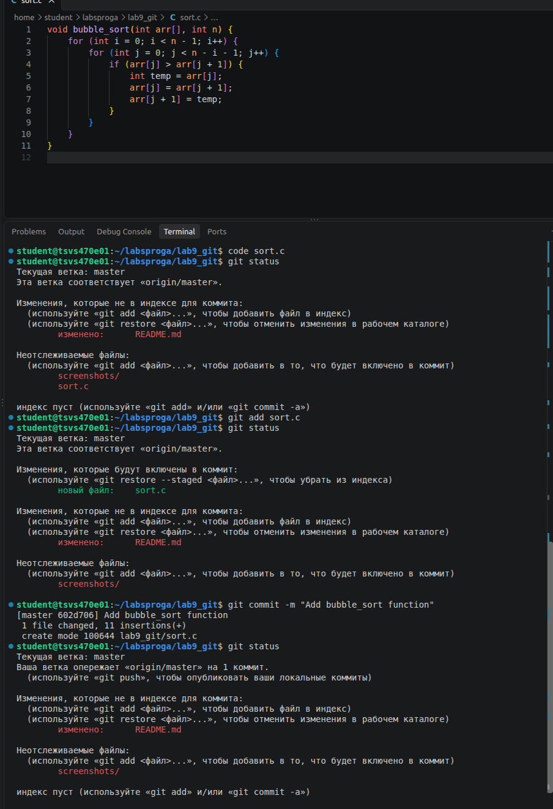
### Пункты 9–17. Редактирование файла и работа со stage
- После первого комментария и `git add` изменение попало в индекс.
- После второго комментария (без `git add`) команда `git commit` зафиксировала только первое изменение, а второе осталось неиндексированным.
- Затем второе изменение было добавлено в индекс, закоммичено и отправлено на GitHub

- Создана ветка `mybranch` (`git branch mybranch`), в списке веток (`git branch`) активная ветка отмечена звездочкой `*`.
- После `git switch mybranch` вывод `git status` изменился: вместо `On branch master` теперь отображается `On branch mybranch`.

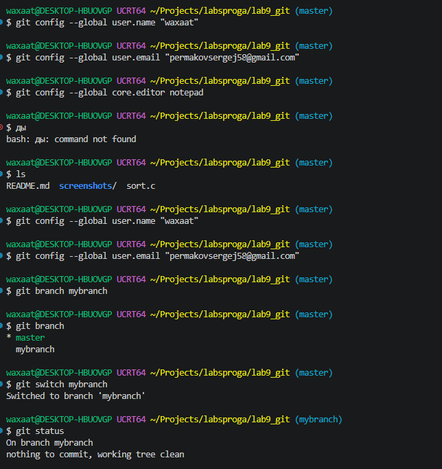
- В ветке `mybranch` создан и закоммичен `file1.txt`. Граф `git log --oneline --graph` показал указатель `mybranch` на новом коммите.
- После возврата в `master` команда `git log --oneline --graph` перестала показывать коммит из `mybranch`.
- После создания и коммита `file2.txt` в `master` команда `git log --oneline --graph --all` показала расхождение веток: у `master` и `mybranch` теперь разные коммиты.

- После переключения на `mybranch` файл `file2.txt` пропал из рабочей директории (так как он существует только в `master`), зато появился `file1.txt`.
- Команда `git diff mybranch master` показала разницу между ветками: удаление `file1.txt` и добавление `file2.txt` при переходе от `mybranch` к `master`.

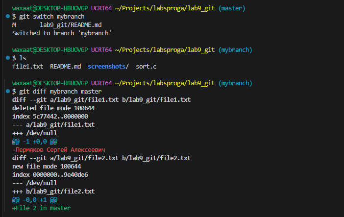

## Оценка 4. Работа с индексом, откаты и слияние веток

### Часть 1: Сравнение изменений (diff) и откат (restore)
- **Пункты 3–7:** До `git add` команда `git diff` показывает добавление `main()` в `sort.c`, а `git diff --staged` пуст. После `git add sort.c` ситуация меняется на противоположную: `git diff` пуст, а `git diff --staged` отображает индексированные изменения.
- **Пункты 8–14:** После удаления элемента массива в `sort.c` файл отобразился в `git status` дважды: в индексе (`{4, 2, 0}`) и в неиндексированных изменениях (`{4, 2}`). Команда `git diff` показала разницу между рабочей копией и индексом, а `git diff --staged` — между индексом и последним коммитом. Команда `git restore --staged sort.c` отменила индексацию.

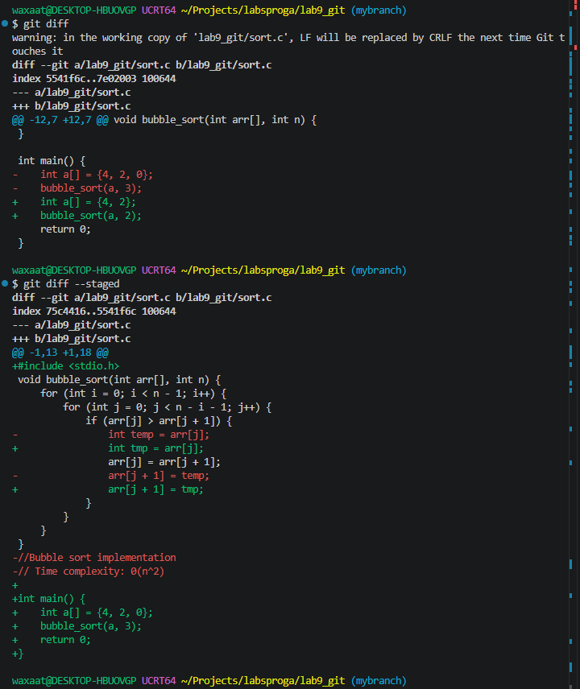

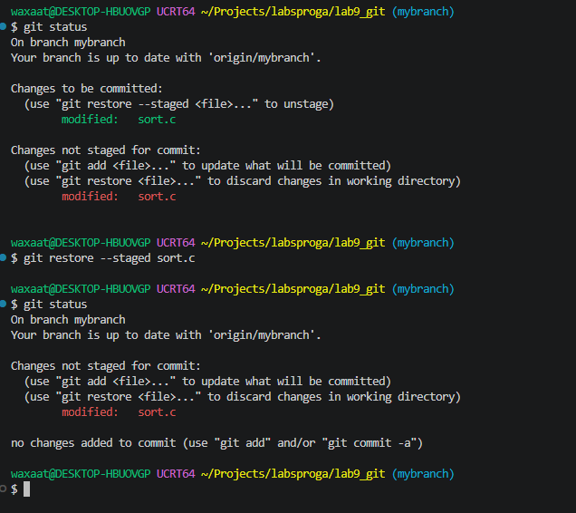

- **Пункты 15–23:** Изменения зафиксированы коммитом в `mybranch`. После добавления `printf("hello git\n");` в `main()` команда `git restore sort.c` откатила неиндексированные правки к состоянию последнего коммита, а обновлённая ветка `mybranch` отправлена на GitHub.

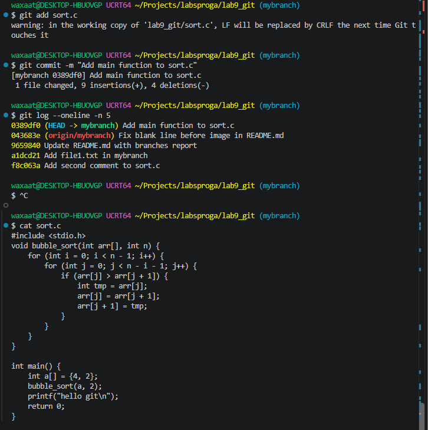

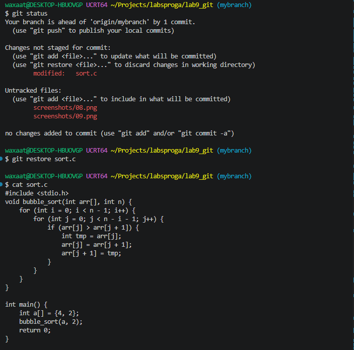

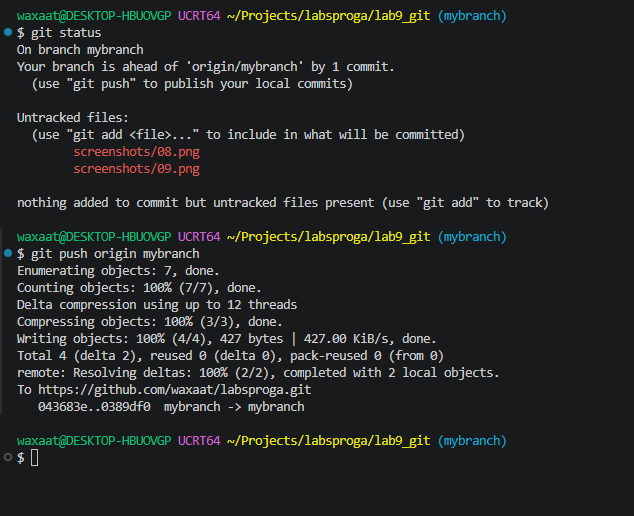

- **Пункты 1–9:** В `master` создан файл `greeting.txt` со словом `hello`, затем создана и активирована ветка `feature/uppercase`, в которой содержимое изменено на `HELLO` и закоммичено.

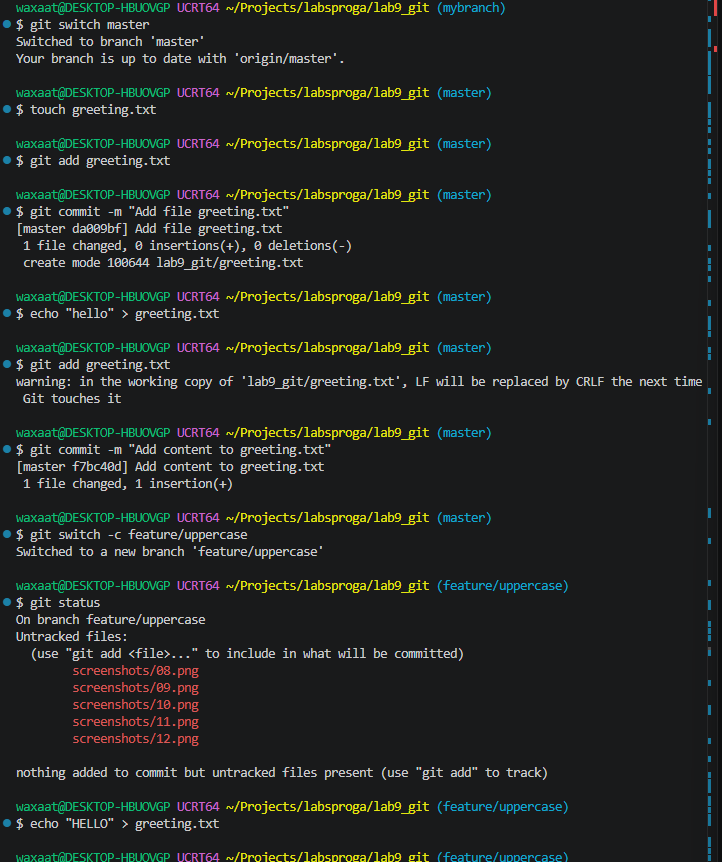

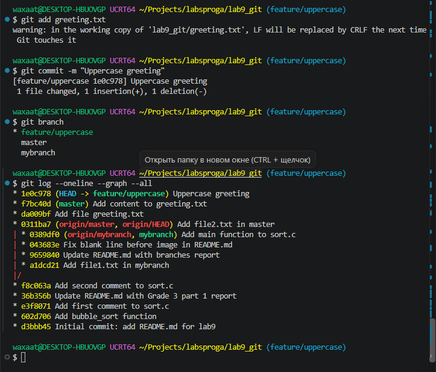

- **Пункты 10–19:** После возврата на `master` файл `greeting.txt` содержал `hello`. После сравнения (`git diff master feature/uppercase`) выполнено слияние `git merge feature/uppercase` в режиме `Fast-forward`, содержимое `greeting.txt` обновилось на `HELLO`, а ветка `feature/uppercase` удалена. Далее ветка `mybranch` влита в `master`, итоговый граф и отчёт отправлены на GitHub.

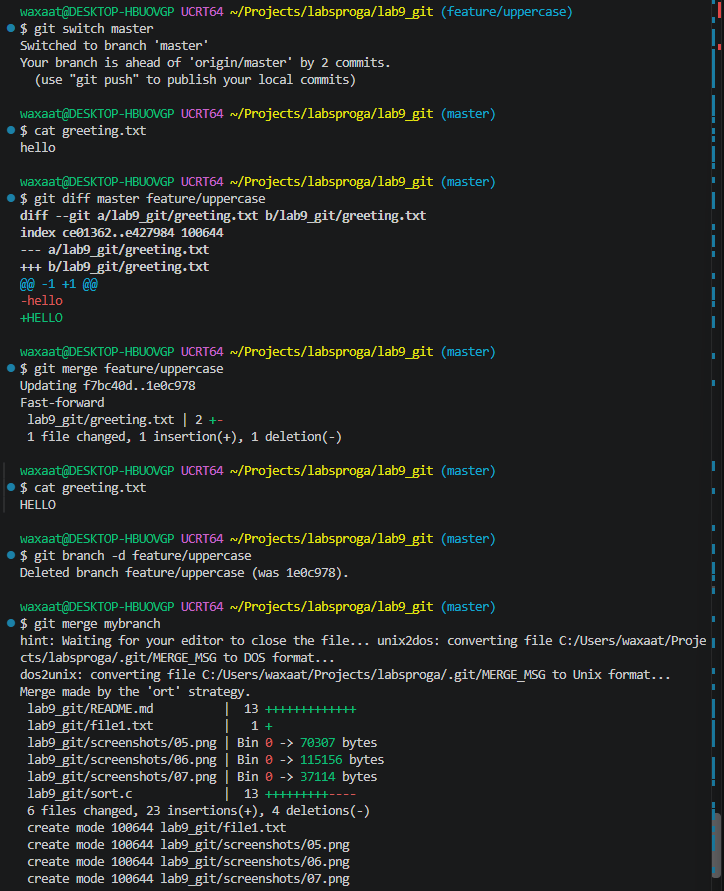

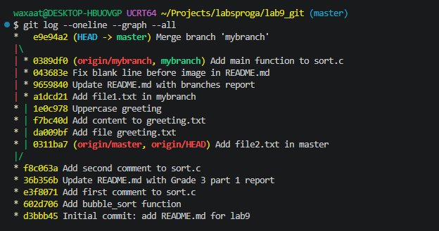
