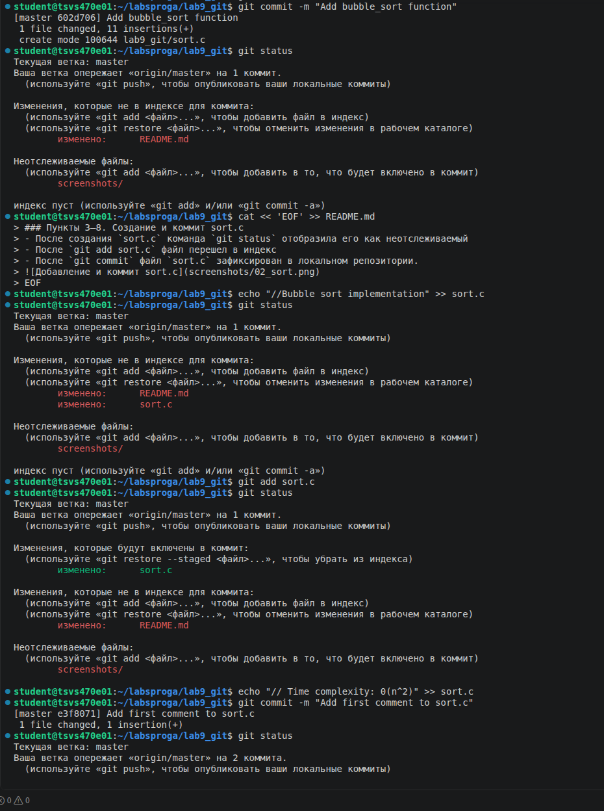
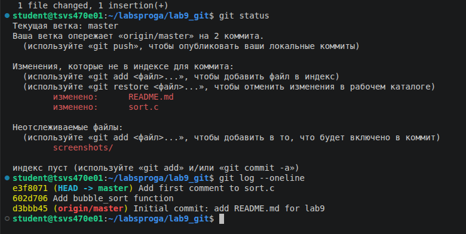
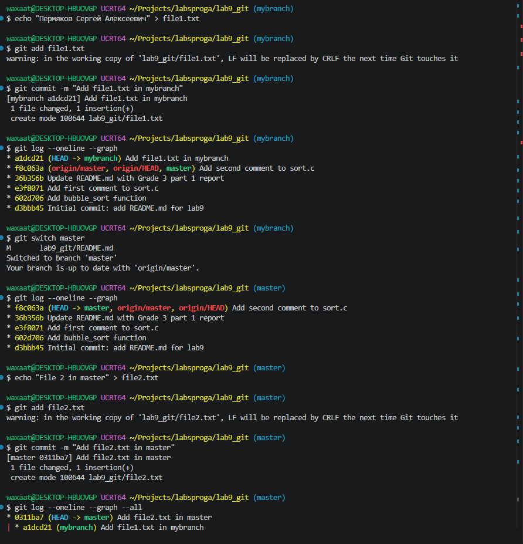

#Практическое задание 9. Git
## Оценка 3. Часть 1: Базовый цикл Git

### Пункты 1-2. Проверка ветки и журнала
- Команда `git status` показала, что мы находимся на ветке `master` изменений нет
- Команда `git log` вывела начальный коммит с файлом `README.md`

### Пункты 3–8. Создание и коммит sort.c
- После создания `sort.c` команда `git status` отобразила его как неотслеживаемый
- После `git add sort.c` файл перешел в индекс
- После `git commit` файл `sort.c` зафиксирован в локальном репозитории.

### Пункты 9–17. Редактирование файла и работа со stage
- После первого комментария и `git add` изменение попало в индекс.
- После второго комментария (без `git add`) команда `git commit` зафиксировала только первое изменение, а второе осталось неиндексированным.
- Затем второе изменение было добавлено в индекс, закоммичено и отправлено на GitHub

- Создана ветка `mybranch` (`git branch mybranch`), в списке веток (`git branch`) активная ветка отмечена звездочкой `*`.
- После `git switch mybranch` вывод `git status` изменился: вместо `On branch master` теперь отображается `On branch mybranch`.

- В ветке `mybranch` создан и закоммичен `file1.txt`. Граф `git log --oneline --graph` показал указатель `mybranch` на новом коммите.
- После возврата в `master` команда `git log --oneline --graph` перестала показывать коммит из `mybranch`.
- После создания и коммита `file2.txt` в `master` команда `git log --oneline --graph --all` показала расхождение веток: у `master` и `mybranch` теперь разные коммиты.

- После переключения на `mybranch` файл `file2.txt` пропал из рабочей директории (так как он существует только в `master`), зато появился `file1.txt`.
- Команда `git diff mybranch master` показала разницу между ветками: удаление `file1.txt` и добавление `file2.txt` при переходе от `mybranch` к `master`.

